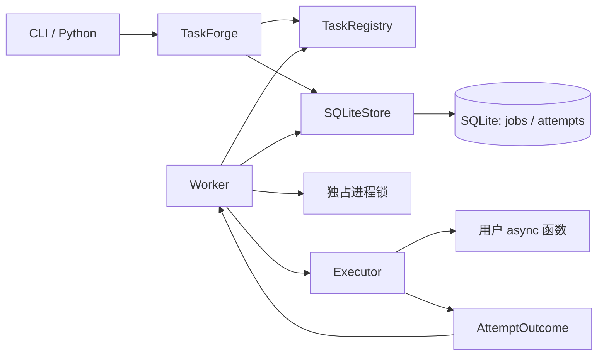

# TaskForge MVP 架构

本文记录已确认的 Step 1 与 Step 2 设计。T01 工程骨架、T02 注册与输入校验、T03 持久化提交与查询、
T04 原子领取与完成、T05 单次执行与超时、T06 Worker 与并发控制、T07 持久化重试及
T08 停机与崩溃恢复、T09 完整 CLI 及 T10 场景与文档已实现。
当前实际验收覆盖 Linux/CPython 3.12；其他平台范围见 docs/verification.md。
GitHub G01 配置、HTTP 与业务状态基础已验收；G02—G05 及整体真实接入待实现、待验收；边界见下文，
任务交接以 [implementation-plan.md](implementation-plan.md) 为准。

## 场景与范围

主要场景为第三方 API 数据同步、异步文件下载与备份、小型应用后台维护。
任务应相对独立、允许短暂排队，并明确其重复执行是否安全。

MVP 包含装饰器注册、Python/CLI 提交、异步并发、持久状态与尝试历史、有限重试、
协作式超时、结构化日志、查询、正常停机及崩溃恢复。
调度范围仅为立即执行和重试延迟。

核心暂不实现 Cron、多 Worker、多机、租约、心跳、CPU 执行池、同步函数自动转线程、
工作流、用户取消、人工重放、Web API、监控页面、Prometheus、PostgreSQL、
业务去重、大型结果存储和完整 stdout/stderr 捕获。

## 模块与调用关系

| 模块 | 职责 |
| --- | --- |
| `registry.py` | 注册、显式加载、参数校验；拒绝重名与同步函数 |
| `api.py` | 提交与查询；提交先校验再入库，查询无需加载用户任务 |
| `storage.py` | 入库、查询、原子领取、完成尝试、恢复；独占事务管理 |
| `db.py` | ORM 表、连接配置、schema 初始化与版本检查 |
| `worker.py` | 获取锁、恢复、轮询、并发槽位、停机编排 |
| `executor.py` | 单次执行、超时、业务异常隔离；不写数据库或决定重试 |
| `policy.py` | 重试与状态决策的纯函数 |
| `models.py` | 状态、执行结果、对外快照；不暴露 ORM 对象 |
| `config.py` / `errors.py` | 配置校验与明确的接口错误 |
| `locking.py` / `logging.py` | 进程互斥、JSON 日志与执行上下文 |
| `cli.py` | Typer 命令、格式化输出和退出码，复用核心接口 |

Worker 内部轮询到期任务，不单独建立 Scheduler 类。只有一种存储实现，不先建立通用
Repository、消息代理或插件体系。模块文件随对应任务创建，不预先添加空实现。

## 注册与接口契约

`TaskDefinition` 是内存中的稳定名称、异步函数、输入模型及默认执行策略。
用户函数接收单个 Pydantic 输入模型并返回 `None`；首期不保存返回值。
模型建议拒绝未知字段，类型转换由模型明确声明。

注册表按 `module:attribute` 加载。任务模块是本地可信代码，不扫描目录，也不在数据库
保存函数对象。提交端与 Worker 应使用一致的任务代码版本。

已实现 `registry.task(...)`、异步 `TaskForge.submit/get/list/history`、
`Worker.run()` 和 `Worker.request_stop()`，以及全部六个 Typer 命令
`init/submit/worker/list/show/history`，打包入口为 `taskforge = taskforge.cli:main`。

提交时先校验参数并保存规范化 JSON；Worker 执行前再次校验。执行策略在提交时保存快照，
修改注册默认值只影响新任务。提交成功表示事务提交完成；结果不确定的提交错误需携带任务 ID，
供调用方查询确认。

## 数据模型

`Job` 表示一次提交，重试保持同一 UUID4 字符串 ID。
`Attempt` 表示一次成功领取，领取提交后即计入次数，包括后续中断的尝试。

### jobs

| 字段 | 含义 |
| --- | --- |
| `id` | UUID4 字符串主键 |
| `task_name` / `params_json` | 稳定名称、校验后的 JSON 对象 |
| `status` | `PENDING / RUNNING / RETRY_WAIT / SUCCESS / FAILED` |
| `created_at` | 提交时间 |
| `started_at` | 首次领取时间，未领取时为空 |
| `finished_at` | 最终结束时间，非终态为空 |
| `next_run_at` | 等待时的到期时间；运行中及终态为空 |
| `attempt_count` | 已成功领取次数，初始为 0 |
| `max_retries` | 最大额外尝试次数，默认 0 |
| `retry_base_seconds` / `retry_cap_seconds` | 指数退避基数与上限 |
| `timeout_seconds` | 每次执行超时 |
| `last_error_kind` / `last_error_message` | 当前错误摘要，可空且限制长度 |

### attempts

| 字段 | 含义 |
| --- | --- |
| `job_id` / `number` | 外键与从 1 开始的序号，复合主键 |
| `status` | `RUNNING / SUCCESS / FAILED / INTERRUPTED` |
| `started_at` / `finished_at` | 领取时间、正常结束或确认中断时间 |
| `error_kind` | `TASK_ERROR / TIMEOUT / CONFIG_ERROR / INTERRUPTED`，可空 |
| `exception_type` / `error_message` / `traceback` | 异常类型、摘要与堆栈，可空且限制文本长度 |

数据库时间为 UTC epoch 微秒整数，对外转换为带时区 `datetime`；执行超时使用单调时钟。
开始时间表示框架领取时间；恢复中的结束时间表示确认中断时间，实际崩溃时刻未知。

数据库约束包括状态值、非负次数、正超时、退避范围及外键。
部分唯一索引限制每个 Job 最多一个 `RUNNING` Attempt。
`(status, next_run_at, created_at, id)` 支持领取，`(created_at, id)` 支持稳定分页。

跨表事务保证领取与完成的一致性、`attempt_count` 与历史数量一致。
成功清空当前错误摘要，历史错误仍保留。

## 事务与执行

使用 SQLAlchemy 2.x 异步接口和 aiosqlite。每次存储操作使用独立、短生命周期的
`AsyncSession`，不跨并发任务共享，不在用户执行期间持有连接或事务。

查询使用普通事务，写操作由存储模块显式控制 `BEGIN IMMEDIATE`。
实现必须统一处理驱动与 SQLAlchemy 的事务开启行为，避免嵌套 `BEGIN`。
锁等待有上限，失败必须明确返回。

| 操作 | 单个事务中的变更 |
| --- | --- |
| 提交 | 插入 `PENDING` Job，`next_run_at=created_at` |
| 领取 | 查找到期任务；条件更新为 `RUNNING`、计数加一；插入 `RUNNING` Attempt |
| 完成 | 校验 Job 和尝试身份及运行状态；结束 Attempt；更新 Job 的终态或重试时间 |
| 恢复 | 将遗留 Attempt 标记中断；按预算将 Job 转为重试等待或最终失败 |

领取排序为 `next_run_at、created_at、id`，条件更新再次检查状态与到期时间。
领取提交后才能执行；完成凭据为 `job_id + attempt number`，过期或重复结果不得覆盖状态。
Worker 槽位覆盖领取、执行和完成持久化全过程。

T04 已实现 SQLiteStore.claim_next() -> AttemptClaim | None 和
finish_attempt(job_id, number, outcome, *, status, next_run_at=None) -> Job。
AttemptClaim 保存不可变 RUNNING Job 快照及 number，job_id 属性与 number 构成凭据。
AttemptOutcome 保存尝试终态与错误详情；接口拒绝不合法组合、过期和重复身份。
失败结果可写 FAILED 或有预算的 RETRY_WAIT，CONFIG_ERROR 不允许重试；
INTERRUPTED 结果要求同名错误类别。RETRY_WAIT 时间必须带时区且严格晚于本次完成时间。
存储层只校验并保存调用方的安排，不计算重试决策或退避。

领取在获得写事务后读取 UTC 微秒时间，条件更新再次检查等待状态、到期与预算；
首次开始时间保留，重试不覆盖，参数与策略快照不变。
完成时间由存储层在完成事务中读取，Attempt 总是结束，终态 Job 同时结束，
重试等待的 Job.finished_at 为空。错误文本分别截断到摘要 2000、类型 256、堆栈 16000
个字符，数据库长度约束仍生效。成功清空当前摘要而保留历史。

两项操作只在 commit 成功后返回快照；commit 前 SQL 故障与取消完整回滚。
commit 开始后的故障或取消返回 ClaimUncertainError / CompletionUncertainError，
携带 job_id 与 number 供 get/history 核对，并复用 _commit 使失败连接失效。
不确定领取不能直接执行；不确定完成不能据此重新执行用户任务。

第 k 次失败后的等待时间为 `min(cap, base × 2^(k−1))`，首期不加抖动。
`max_retries=N` 最多 `N+1` 次尝试；未知任务或参数不匹配不重试。
重试时间存于数据库，不依赖长时间内存 sleep。

T07 已实现 policy.decide_completion(job, outcome) -> CompletionDecision 和
policy.retry_delay_seconds(job) -> float。决策仅使用不可变 Job 快照：SUCCESS 直接成功，
CONFIG_ERROR 直接失败，TASK_ERROR/TIMEOUT 有预算则 RETRY_WAIT，否则最终失败。
T08 将同样的预算与退避决策扩展至 INTERRUPTED；领取已消耗预算，中断不再增加次数。
浮点分解与指数比较先判定封顶，不构造巨大整数幂，也不产生无穷延迟。

Worker 将决策的 retry_delay_seconds 传给 finish_attempt 的新增同名关键字参数。
存储在已取得写事务并确认凭据后，以本次完成时间加延迟生成 next_run_at；
原有 next_run_at 绝对时间接口保留，二者互斥。相对延迟须为有限正数，只可用于 RETRY_WAIT，
向上取整到微秒（至少 1 微秒），日期超出可表示范围时封顶为 UTC datetime.max。
存储继续校验预算和严格未来时间；不决定重试或计算退避，不变更事务开启及 _commit 清理。
完成 commit 后释放槽位，既有轮询负责领取到期 Job；重启保留等待 Job 的原到期时间。

## 锁、恢复与停机

首期支持 Linux/macOS 本地文件系统。锁文件位于规范化数据库路径旁，使用
`fcntl.flock` 非阻塞独占锁，整个 Worker 生命周期保持文件描述符。
退出关闭描述符但不删除锁文件，避免不同进程锁住不同文件实例。

启动顺序为校验配置并加载注册表、获取锁、校验 schema、完成遗留恢复、开始领取。
只有取得锁后才能认定旧 Worker 已退出。

恢复逐个 Job 使用短事务：遗留尝试标记 `INTERRUPTED`；有预算则从确认中断时计算退避，
无预算则进入 `FAILED`。恢复再次中断时，已提交记录不再为运行状态，未提交记录下次继续恢复。
其他等待任务保留原到期时间；终态任务不自动重启。

T08 已实现 SQLiteStore.get_running_attempt() -> AttemptClaim | None：短查询读取首个遗留
RUNNING Job 的当前凭据；该接口不授予锁或执行所有权。Worker 持锁完成 schema 检查后循环
读取凭据，调用纯 decide_completion，再通过既有 finish_attempt 原子提交每个中断结果。
完成事务重新校验 Job/Attempt 的身份与运行状态，使用相对延迟从确认中断时安排重试。
无需新表、schema 版本或第二套提交机制；恢复故障停止启动，不执行正常领取。
SQL/commit 故障和取消复用 StorageError/CompletionUncertainError 及原异常链与可查询凭据。

停机先停止领取，再等待运行任务；宽限期后请求取消。协程实际结束后才记录中断并释放槽位。
不响应取消的任务需要报告停机未完成并继续持锁；框架不承诺硬超时。

T05 已实现 Executor(registry).execute(claim) -> AttemptOutcome、JSONFormatter 和
contextvars 执行身份。执行器不接收存储对象，不计算重试，按 Job 快照重新校验参数与计时。
外部取消等待用户协程实际结束后传播 CancelledError，重复取消不会再次打断清理；
清理期间收到外部取消优先于超时。不会自行生成 INTERRUPTED 持久结果。
正常返回必须为 None；违反契约抛 ExecutorError，底层 TypeError 保留为 cause。
模型校验的 ValidationError 属于 CONFIG_ERROR，validator 编程故障及执行机制故障
属于 ExecutorError。错误详情交由既有 finish_attempt 截断。

业务异常属于 `TASK_ERROR`，框架计时器触发才属于 `TIMEOUT`。
任务自行抛出的 `TimeoutError` 仍属于业务异常。
`EXECUTOR_ERROR` 是 Worker 级错误：停止领取、输出结构化错误并非零退出；
无法可靠持久化的运行尝试留待重启恢复，不伪装成业务失败。

T06 已实现 Worker(store, registry, config=None)、WorkerConfig 和 WorkerLockError。
WorkerConfig 的 concurrency 默认 4、poll_interval_seconds 默认 1.0，分别校验正整数和
有限正数。Worker 使用调用方已初始化的存储，先获锁，再以短查询拒绝未初始化版本，
复用 initialize 检查现有表与列后开始领取；没有新增事务开启或清理机制。
每个固定异步槽位覆盖领取、执行、完成 commit，领取入口串行并在进入前检查停止标志，
用户执行及完成写入可重叠。空槽位按轮询间隔等待，request_stop 唤醒等待并停止新领取。
T06 初始版本已进入存储的领取继续完成并执行，正常退出只等待所有槽位；
T08 使用下面的宽限期停机规则。
T06 初始版本成功写 SUCCESS、普通失败写最终 FAILED；T07 已接入上述持久化重试决策。

数据库故障、不确定结果和 ExecutorError 停止新领取，等待其他已启动槽位结束后
传播原异常，已知凭据写入 worker_error 结构化日志。不确定领取不执行，不确定完成
不重交或重执行；由调用方用 get/history 查询凭据确认。锁描述符保持到所有槽位结束，
退出关闭而不删除锁文件；不同数据库独立。每个 Worker 实例只运行一次。

T08 新增 WorkerConfig.shutdown_grace_seconds，默认 30.0，严格校验有限非负数，
允许 0 立即请求协作取消，拒绝布尔值和字符串。request_stop、外部取消及框架故障停止新领取，
唤醒空槽位并等待宽限期。到期只向活动 Executor 任务请求一次取消，用户真正退出后
Worker 才保存 INTERRUPTED 并释放槽位。重复外部取消被屏蔽，run 最后传播原外部取消。
自行取消的用户执行同样保存中断并停止领取，继续传播取消；Executor 自身契约不变。
已开始的领取、恢复、完成事务不被停机取消；领取晚于宽限期确认时不开始用户函数，
使用已提交凭据保存中断。已开始的完成写入保留原结果，不重交不确定结果。
宽限期后仍有执行任务时记录 WARNING shutdown_incomplete，带任务与尝试身份；
该事件表示仍在等待，不表示历史已完成。忽略取消时继续占槽持锁，没有硬超时机制。

外部副作用与 Job 成功写入无法原子提交，崩溃恢复可能重复执行。稳定任务 ID 可以辅助业务幂等，
不提供恰好执行一次或业务去重保证。

## 日志、schema 与验证

T09 的 CLI 只编排核心接口：init 显式 initialize；submit 显式加载注册表并读取文件/stdin JSON，
调用 TaskForge.submit；list/show/history 不导入任务模块；worker 管理存储生命周期并调用 Worker.run。
本地模块须位于 Python 搜索路径，不自动扫描目录。输入、输出、分页游标与退出码见 README 的 CLI 节。
CLI 在连接前检查数据库父目录与文件类型，不创建目录，不改驱动或事务清理。
Worker 命令安装 SIGINT/SIGTERM handler，只调用 request_stop；重复信号不取消执行器或清理。
直到 Worker 真正退出才恢复信号 handler、关闭存储；框架日志使用既有 JSONFormatter 写 stderr。
不确定错误报告保留 job_id/attempt_number，退出码 9；不确定领取不执行、不确定完成不重交。
持久业务/配置失败通过查询呈现，Worker 正常停机返回 0；框架、存储、锁等故障非零退出。

T05—T08 使用标准库 logging 与 JSONFormatter，记录 time、level、event、job_id、attempt_number 和 error_kind。
contextvars 关联执行上下文，不默认记录完整参数。持久执行历史与实时日志分开，
不承诺崩溃前最后几条日志全部保留。

数据库通过显式初始化建立 schema 并记录版本，不兼容版本明确拒绝。
初始建表不承担后续迁移，不在首期引入迁移框架。

策略与注册使用单元测试；存储、并发、CLI 与崩溃恢复使用真实临时数据库及子进程。
事件与屏障控制并发，可替换内部时钟控制时间，不以固定长 sleep 作为同步条件。

T10 的 `examples/` 提供 loopback API 替身、异步同步/下载备份/维护注册表、Python 闭环及
真实 CLI 场景验收脚本；例子随 sdist 分发，wheel 仅包含核心包和 CLI。
崩溃屏障只在验收子进程中暂停 SUCCESS commit 前的执行，不替换真实持久化。
独立业务 SQLite 以稳定 Job ID 唯一键和副作用同事务提交，证明重复执行时副作用从两条
降至一条；该逻辑属于示例业务，不是核心去重能力。步骤见 [scenarios.md](scenarios.md)，
实测收据见 [verification-t10.json](verification-t10.json)。

## GitHub 接入边界

本节记录已登记的业务设计，实际验收仍以 [verification.md](verification.md) 为准。
接入结构、输入、身份、默认预算、采集及恢复的设计细则由
[github-integration-plan.md](github-integration-plan.md) 维护；实现按 G01—G05 分会话推进。
该接入细化一周业务提案的 GitHub 部分，独立于 Obsidian 备份。

G01 已实现并验收：严格来源/预算/输入配置、七来源默认 JSON、内存认证、固定版本 HTTP、
ETag 分页缓存、共享持久冷却、来源与 API 文件锁、独立版本化业务 schema 和原子完成标记。
当前全量 612 项测试及质量、构建、归档检查通过；具体证据见验证文档 G01 节。
采集、注册、业务命令、导出和真实七来源验证尚未实现，下述相关契约仍为后续任务设计。
业务实际接口与 G02 前置条件见 [G02 prompt](prompts/G02.md)。

### 来源、运行与分发

首批固定为七个来源：mattpocock/skills、addyosmani/agent-skills 采集默认分支 Commit、
Release 与原生 Git tree 中普通 SKILL.md 的定义变化；yetone/magpie、tt-a1i/archify、
deepseek-ai/deepseek-harness、morluto/rea 采集默认分支 Commit 与 Release；
openai/codex 采集有限 Issue 基线及新增、更新、关闭和重开，排除 PR。
来源由拒绝未知字段的 JSON 配置管理，不自动发现其他仓库。

运行限定单机、单 Worker、WSL/Linux 本地文件系统，手动触发，使用 httpx.AsyncClient。
业务代码位于 integrations/github/，使用项目源码运行并加入 sdist；wheel 继续分发核心包和 CLI。
新增 github 可选依赖，具体约束与安装顺序见接入设计细则。
默认业务目录为已被忽略的 .taskforge/github/，允许显式指定其他 Linux 本地目录。

### 核心复用与业务职责

业务注册表为 integrations.github.tasks:registry，仅注册 github.refresh。
任务接收单个 Pydantic 输入模型并返回 None，通过 get_execution_context() 获取 Job/Attempt；
输入保存 refresh_id、规范化业务目录、非敏感来源与预算快照、来源代次和操作类型。
采集逻辑与任务包装分离，以独立执行身份供 direct 对照复用。

业务入口 python -m integrations.github 提供 init、submit、reconcile、show、export、direct。
提交及查询复用公开 TaskForge.submit/get/list/history，Worker 使用已有核心 CLI；
业务模块不访问核心私有表，不另写 Worker、核心重试或信号处理。
核心源码与公共接口保持现状，业务永久错误仍消耗已有有限 TASK_ERROR 重试预算。

核心任务数据库保存 Job/Attempt，独立业务数据库使用已有 aiosqlite 保存来源、检查点、
提交意图、批次、业务记录与变化、技能快照、Release 身份清单、HTTP 缓存及冷却状态。
业务数据库显式版本化，使用短事务和有界锁等待；网络请求期间不持数据库事务。
实体身份、内容指纹和 refresh_id 完成标记承担业务去重，核心仍不保证恰好执行一次。

### 一致性、恢复与产物

同一来源由异步互斥与非阻塞文件锁串行覆盖检查点读取、采集、业务提交和批次收据生成。
同一业务实例所有来源共用并发为 1 的请求门控及持久冷却，文件锁覆盖 Worker 与 direct；
请求遵守分页、请求数与等待预算，HTTP 层不额外自动重试，凭据只驻留内存。

项目尝试固定目标 SHA；Commit、Release 身份分页和完整技能快照共同通过后，
记录、完整性、检查点及批次完成标记才同事务提交。历史异常需显式重新建立基线，
树不完整时不能推断删除。Release 持续监测已保存及后续新增记录的内容编辑，
初始窗口之外的旧 Release 仅登记身份。Issue 使用有限基线、60 秒重叠窗口及尝试上界，
完整分页后才提交检查点，保存观察到的状态，不还原刷新间的全部事件。

未提交尝试重试时读取最新检查点；来源配置换仓库、类型或筛选时显式重新建立基线，
旧代次不得覆盖新检查点。已完成业务批次重试时核对完成标记并修复导出。
业务 commit 不确定时等待数据库操作结束，以独立连接核对完成标记后再决定下一步；
取消须等 HTTP、数据库与凭据子进程完成清理，再释放锁并传播。
两份数据库无法原子提交，提交入口先保存意图，再关联 Job；不确定或中断后由 reconcile
通过公开查询核对，无法确认时保持待核对，不盲目再次 submit。

业务数据库为结果依据，JSON 收据和最小 Markdown 索引可以从数据库重建，文件原子替换；
导出失败不回滚已提交数据。收据区分初始化、自然更新、历史重放和故障实验，
包含执行身份、源码与配置指纹、前后检查点、覆盖范围、计数、诊断、耗时及核验结论。
公开收据排除凭据和个人完整路径。业务 submit --rebaseline 是新基线操作，
历史 SHA 重放仅用于隔离验收，两者均不增加核心人工重放能力。

本轮不增加周期调度、Web UI、LLM 摘要、技能安装或执行、完整评论线程采集、
普通 tag 与 Release 附件下载，也不接入 Obsidian 报告写入或备份。
默认测试使用受控 API 与临时数据库；真实七来源、历史重放和对照实验由 G05 单独验收。

## 技术依据

- [SQLAlchemy SQLite dialect](https://docs.sqlalchemy.org/en/20/dialects/sqlite.html)：aiosqlite 与事务控制。
- [SQLAlchemy Session 并发规则](https://docs.sqlalchemy.org/en/20/orm/session_basics.html#is-the-session-thread-safe-is-asyncsession-safe-to-share-in-concurrent-tasks)。
- [SQLite 事务](https://www.sqlite.org/lang_transaction.html)：单写事务、IMMEDIATE 与锁竞争。
- [Python asyncio](https://docs.python.org/3.12/library/asyncio-task.html)：协作式取消与超时。
- [Python fcntl](https://docs.python.org/3.12/library/fcntl.html)：Unix 文件锁。
