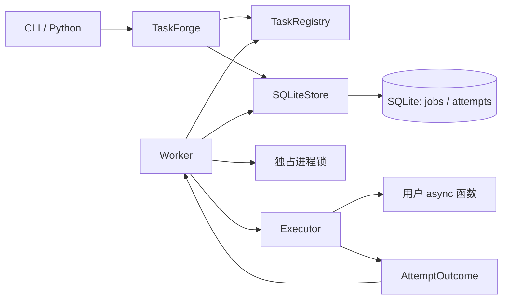

# TaskForge MVP 架构

本文记录已确认的 Step 1 与 Step 2 设计。T01 工程骨架、T02 注册与输入校验、T03 持久化提交与查询、
T04 原子领取与完成、T05 单次执行与超时及 T06 Worker 与并发控制已实现；
其余能力为待实现设计，实际验收状态见 docs/verification.md。

## 场景与范围

主要场景为第三方 API 数据同步、异步文件下载与备份、小型应用后台维护。
任务应相对独立、允许短暂排队，并明确其重复执行是否安全。

MVP 包含装饰器注册、Python/CLI 提交、异步并发、持久状态与尝试历史、有限重试、
协作式超时、结构化日志、查询、正常停机及崩溃恢复。
调度范围仅为立即执行和重试延迟。

暂不实现 Cron、多 Worker、多机、租约、心跳、CPU 执行池、同步函数自动转线程、
工作流、用户取消、人工重放、Web API、监控页面、Prometheus、PostgreSQL、
业务去重、大型结果存储和完整 stdout/stderr 捕获。

## 模块与调用关系

| 模块 | 职责 |
| --- | --- |
| `registry.py` | 注册、显式加载、参数校验；拒绝重名与同步函数 |
| `api.py` | 提交与查询；提交先校验再入库，查询无需加载用户任务 |
| `storage.py` | 入库、查询、原子领取、完成尝试、恢复；独占事务管理 |
| `db.py` | ORM 表、连接配置、schema 初始化与版本检查 |
| `worker.py` | 获取锁、恢复、轮询、并发槽位、停机编排 |
| `executor.py` | 单次执行、超时、业务异常隔离；不写数据库或决定重试 |
| `policy.py` | 重试与状态决策的纯函数 |
| `models.py` | 状态、执行结果、对外快照；不暴露 ORM 对象 |
| `config.py` / `errors.py` | 配置校验与明确的接口错误 |
| `locking.py` / `logging.py` | 进程互斥、JSON 日志与执行上下文 |
| `cli.py` | Typer 命令、格式化输出和退出码，复用核心接口 |

Worker 内部轮询到期任务，不单独建立 Scheduler 类。只有一种存储实现，不先建立通用
Repository、消息代理或插件体系。模块文件随对应任务创建，不预先添加空实现。

## 注册与接口契约

`TaskDefinition` 是内存中的稳定名称、异步函数、输入模型及默认执行策略。
用户函数接收单个 Pydantic 输入模型并返回 `None`；首期不保存返回值。
模型建议拒绝未知字段，类型转换由模型明确声明。

注册表按 `module:attribute` 加载。任务模块是本地可信代码，不扫描目录，也不在数据库
保存函数对象。提交端与 Worker 应使用一致的任务代码版本。

公共操作规划为 `registry.task(...)`、异步 `TaskForge.submit/get/list/history`、
`Worker.run()` 和 `Worker.request_stop()`。CLI 命令规划为
`init/submit/worker/list/show/history`。已实现 `registry.task(...)`、异步 `TaskForge.submit/get/list/history` 及 Worker 接口；CLI 尚不存在。

提交时先校验参数并保存规范化 JSON；Worker 执行前再次校验。执行策略在提交时保存快照，
修改注册默认值只影响新任务。提交成功表示事务提交完成；结果不确定的提交错误需携带任务 ID，
供调用方查询确认。

## 数据模型

`Job` 表示一次提交，重试保持同一 UUID4 字符串 ID。
`Attempt` 表示一次成功领取，领取提交后即计入次数，包括后续中断的尝试。

### jobs

| 字段 | 含义 |
| --- | --- |
| `id` | UUID4 字符串主键 |
| `task_name` / `params_json` | 稳定名称、校验后的 JSON 对象 |
| `status` | `PENDING / RUNNING / RETRY_WAIT / SUCCESS / FAILED` |
| `created_at` | 提交时间 |
| `started_at` | 首次领取时间，未领取时为空 |
| `finished_at` | 最终结束时间，非终态为空 |
| `next_run_at` | 等待时的到期时间；运行中及终态为空 |
| `attempt_count` | 已成功领取次数，初始为 0 |
| `max_retries` | 最大额外尝试次数，默认 0 |
| `retry_base_seconds` / `retry_cap_seconds` | 指数退避基数与上限 |
| `timeout_seconds` | 每次执行超时 |
| `last_error_kind` / `last_error_message` | 当前错误摘要，可空且限制长度 |

### attempts

| 字段 | 含义 |
| --- | --- |
| `job_id` / `number` | 外键与从 1 开始的序号，复合主键 |
| `status` | `RUNNING / SUCCESS / FAILED / INTERRUPTED` |
| `started_at` / `finished_at` | 领取时间、正常结束或确认中断时间 |
| `error_kind` | `TASK_ERROR / TIMEOUT / CONFIG_ERROR / INTERRUPTED`，可空 |
| `exception_type` / `error_message` / `traceback` | 异常类型、摘要与堆栈，可空且限制文本长度 |

数据库时间为 UTC epoch 微秒整数，对外转换为带时区 `datetime`；执行超时使用单调时钟。
开始时间表示框架领取时间；恢复中的结束时间表示确认中断时间，实际崩溃时刻未知。

数据库约束包括状态值、非负次数、正超时、退避范围及外键。
部分唯一索引限制每个 Job 最多一个 `RUNNING` Attempt。
`(status, next_run_at, created_at, id)` 支持领取，`(created_at, id)` 支持稳定分页。

跨表事务保证领取与完成的一致性、`attempt_count` 与历史数量一致。
成功清空当前错误摘要，历史错误仍保留。

## 事务与执行

使用 SQLAlchemy 2.x 异步接口和 aiosqlite。每次存储操作使用独立、短生命周期的
`AsyncSession`，不跨并发任务共享，不在用户执行期间持有连接或事务。

查询使用普通事务，写操作由存储模块显式控制 `BEGIN IMMEDIATE`。
实现必须统一处理驱动与 SQLAlchemy 的事务开启行为，避免嵌套 `BEGIN`。
锁等待有上限，失败必须明确返回。

| 操作 | 单个事务中的变更 |
| --- | --- |
| 提交 | 插入 `PENDING` Job，`next_run_at=created_at` |
| 领取 | 查找到期任务；条件更新为 `RUNNING`、计数加一；插入 `RUNNING` Attempt |
| 完成 | 校验 Job 和尝试身份及运行状态；结束 Attempt；更新 Job 的终态或重试时间 |
| 恢复 | 将遗留 Attempt 标记中断；按预算将 Job 转为重试等待或最终失败 |

领取排序为 `next_run_at、created_at、id`，条件更新再次检查状态与到期时间。
领取提交后才能执行；完成凭据为 `job_id + attempt number`，过期或重复结果不得覆盖状态。
Worker 槽位覆盖领取、执行和完成持久化全过程。

T04 已实现 SQLiteStore.claim_next() -> AttemptClaim | None 和
finish_attempt(job_id, number, outcome, *, status, next_run_at=None) -> Job。
AttemptClaim 保存不可变 RUNNING Job 快照及 number，job_id 属性与 number 构成凭据。
AttemptOutcome 保存尝试终态与错误详情；接口拒绝不合法组合、过期和重复身份。
失败结果可写 FAILED 或有预算的 RETRY_WAIT，CONFIG_ERROR 不允许重试；
INTERRUPTED 结果要求同名错误类别。RETRY_WAIT 时间必须带时区且严格晚于本次完成时间。
存储层只校验并保存调用方的安排，不计算重试决策或退避。

领取在获得写事务后读取 UTC 微秒时间，条件更新再次检查等待状态、到期与预算；
首次开始时间保留，重试不覆盖，参数与策略快照不变。
完成时间由存储层在完成事务中读取，Attempt 总是结束，终态 Job 同时结束，
重试等待的 Job.finished_at 为空。错误文本分别截断到摘要 2000、类型 256、堆栈 16000
个字符，数据库长度约束仍生效。成功清空当前摘要而保留历史。

两项操作只在 commit 成功后返回快照；commit 前 SQL 故障与取消完整回滚。
commit 开始后的故障或取消返回 ClaimUncertainError / CompletionUncertainError，
携带 job_id 与 number 供 get/history 核对，并复用 _commit 使失败连接失效。
不确定领取不能直接执行；不确定完成不能据此重新执行用户任务。

第 k 次失败后的等待时间为 `min(cap, base × 2^(k−1))`，首期不加抖动。
`max_retries=N` 最多 `N+1` 次尝试；未知任务或参数不匹配不重试。
重试时间存于数据库，不依赖长时间内存 sleep。

## 锁、恢复与停机

首期支持 Linux/macOS 本地文件系统。锁文件位于规范化数据库路径旁，使用
`fcntl.flock` 非阻塞独占锁，整个 Worker 生命周期保持文件描述符。
退出关闭描述符但不删除锁文件，避免不同进程锁住不同文件实例。

启动顺序为校验配置并加载注册表、获取锁、校验 schema、完成遗留恢复、开始领取。
只有取得锁后才能认定旧 Worker 已退出。

恢复逐个 Job 使用短事务：遗留尝试标记 `INTERRUPTED`；有预算则从确认中断时计算退避，
无预算则进入 `FAILED`。恢复再次中断时，已提交记录不再为运行状态，未提交记录下次继续恢复。
其他等待任务保留原到期时间；终态任务不自动重启。

停机先停止领取，再等待运行任务；宽限期后请求取消。协程实际结束后才记录中断并释放槽位。
不响应取消的任务需要报告停机未完成并继续持锁；框架不承诺硬超时。

T05 已实现 Executor(registry).execute(claim) -> AttemptOutcome、JSONFormatter 和
contextvars 执行身份。执行器不接收存储对象，不计算重试，按 Job 快照重新校验参数与计时。
外部取消等待用户协程实际结束后传播 CancelledError，重复取消不会再次打断清理；
清理期间收到外部取消优先于超时。不会自行生成 INTERRUPTED 持久结果。
正常返回必须为 None；违反契约抛 ExecutorError，底层 TypeError 保留为 cause。
模型校验的 ValidationError 属于 CONFIG_ERROR，validator 编程故障及执行机制故障
属于 ExecutorError。错误详情交由既有 finish_attempt 截断。

业务异常属于 `TASK_ERROR`，框架计时器触发才属于 `TIMEOUT`。
任务自行抛出的 `TimeoutError` 仍属于业务异常。
`EXECUTOR_ERROR` 是 Worker 级错误：停止领取、输出结构化错误并非零退出；
无法可靠持久化的运行尝试留待重启恢复，不伪装成业务失败。

T06 已实现 Worker(store, registry, config=None)、WorkerConfig 和 WorkerLockError。
WorkerConfig 的 concurrency 默认 4、poll_interval_seconds 默认 1.0，分别校验正整数和
有限正数。Worker 使用调用方已初始化的存储，先获锁，再以短查询拒绝未初始化版本，
复用 initialize 检查现有表与列后开始领取；没有新增事务开启或清理机制。
每个固定异步槽位覆盖领取、执行、完成 commit，领取入口串行并在进入前检查停止标志，
用户执行及完成写入可重叠。空槽位按轮询间隔等待，request_stop 唤醒等待并停止新领取。
已进入存储的领取继续完成并执行；正常退出等待所有槽位，不取消正在运行的用户任务。
成功写 SUCCESS，普通失败写最终 FAILED；重试决策留在 T07。

数据库故障、不确定结果和 ExecutorError 停止新领取，等待其他已启动槽位结束后
传播原异常，已知凭据写入 worker_error 结构化日志。不确定领取不执行，不确定完成
不重交或重执行；由调用方用 get/history 查询凭据确认。锁描述符保持到所有槽位结束，
退出关闭而不删除锁文件；不同数据库独立。外部取消 run 只停止领取，屏蔽重复取消
对已启动工作的干扰，等待真实结束后传播取消，不新增中断结果。
每个 Worker 实例只运行一次。T06 不实现停机宽限期、主动取消、恢复或 CLI。
T08 前遗留 RUNNING 尝试保持原状态，不会被领取；不响应超时取消的用户协程持续占槽并持锁。

外部副作用与 Job 成功写入无法原子提交，崩溃恢复可能重复执行。稳定任务 ID 可以辅助业务幂等，
不提供恰好执行一次或业务去重保证。

## 日志、schema 与验证

T05—T06 使用标准库 logging 与 JSONFormatter，记录 time、level、event、job_id、attempt_number 和 error_kind。
contextvars 关联执行上下文，不默认记录完整参数。持久执行历史与实时日志分开，
不承诺崩溃前最后几条日志全部保留。

数据库通过显式初始化建立 schema 并记录版本，不兼容版本明确拒绝。
初始建表不承担后续迁移，不在首期引入迁移框架。

策略与注册使用单元测试；存储、并发、CLI 与崩溃恢复使用真实临时数据库及子进程。
事件与屏障控制并发，可替换内部时钟控制时间，不以固定长 sleep 作为同步条件。

## 技术依据

- [SQLAlchemy SQLite dialect](https://docs.sqlalchemy.org/en/20/dialects/sqlite.html)：aiosqlite 与事务控制。
- [SQLAlchemy Session 并发规则](https://docs.sqlalchemy.org/en/20/orm/session_basics.html#is-the-session-thread-safe-is-asyncsession-safe-to-share-in-concurrent-tasks)。
- [SQLite 事务](https://www.sqlite.org/lang_transaction.html)：单写事务、IMMEDIATE 与锁竞争。
- [Python asyncio](https://docs.python.org/3.12/library/asyncio-task.html)：协作式取消与超时。
- [Python fcntl](https://docs.python.org/3.12/library/fcntl.html)：Unix 文件锁。
